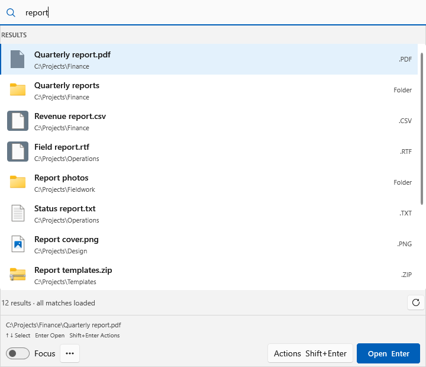

  

<h1 align="center">Search &amp; Launch</h1>

Find files, folders, apps, and Windows settings from the keyboard. Use the launcher on its own, in File Explorer, or in an Open or Save dialog.

  <strong><a href="https://github.com/Thypari/SearchAndLaunch-Releases/releases/latest">Download for Windows 11 (x64)</a></strong>
  &nbsp;·&nbsp;
  <a href="https://github.com/Thypari/SearchAndLaunch-Releases/releases">Release notes</a>

## Find a result in Focus

Press <kbd>Ctrl</kbd> + <kbd>Alt</kbd> + <kbd>Space</kbd> to open **Focus**. Type part of a filename, paste a path, or enter an app name. In the example below, `report` finds both *Quarterly report.pdf* and the *Quarterly reports* folder.

  <picture>
    <source media="(prefers-color-scheme: dark)" srcset="media/focus-dark.png">
    
  </picture>

Use <kbd>↑</kbd> or <kbd>↓</kbd> to select a result and <kbd>Enter</kbd> to open it. Press <kbd>Shift</kbd> + <kbd>Enter</kbd> for more actions, including **Reveal in File Explorer** for files. Items you open can rank higher in later searches that match them.

## Compare results in Workspace

If several files have similar names, switch from Focus to **Workspace** to keep your search and compare their locations, sizes, and modification dates. Use **Within folder** to narrow the search to a project, or enter `pdf` in **Extension**. Select a row to inspect its full path or copy it.

  <picture>
    <source media="(prefers-color-scheme: dark)" srcset="media/workspace-dark.png">
    
  </picture>

## Search inside Explorer and file dialogs

**In File Explorer**, click the magnifier in the search box or press the launcher shortcut. Search starts in the current folder. Choose a folder result to navigate there in the same Explorer window.

**In a supported Open or Save dialog**, the search panel appears automatically. Choose a folder to navigate there while keeping the filename you already typed. Choose a file to pass it to the dialog. The button beside **File name** hides or shows the panel.

  

## Install and make it yours

1. Open the [latest release](https://github.com/Thypari/SearchAndLaunch-Releases/releases/latest) and download the **Windows x64 MSI** under **Assets**.
2. Run the installer. Administrator approval installs the shared indexing service. Choose whether Start menu and sign-in shortcuts are for **this user** or **all users**.
3. Open the launcher from the tray beside the clock or press <kbd>Ctrl</kbd> + <kbd>Alt</kbd> + <kbd>Space</kbd>. On first use, the service indexes file and folder names on supported local NTFS drives in the background.

In **Settings**, you can change shortcuts, choose a light or dark theme, and hide selected folders from search while **Confidential** protection is locked. Under **Index → Manage index**, you can exclude locations from indexing or adjust the percentage of the index kept in memory.

The app checks for updates at launch by default. You can change that under **Settings → General → Updates**, or choose **Check for Update** from the tray menu at any time.
