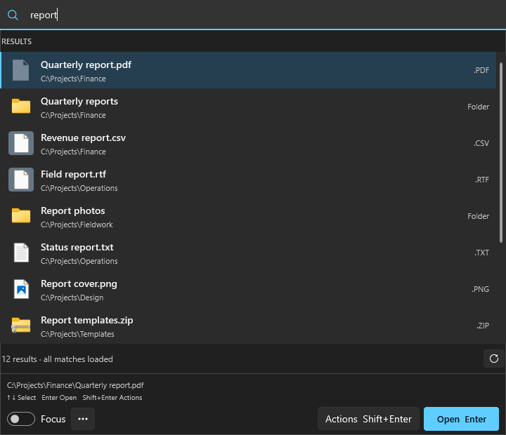
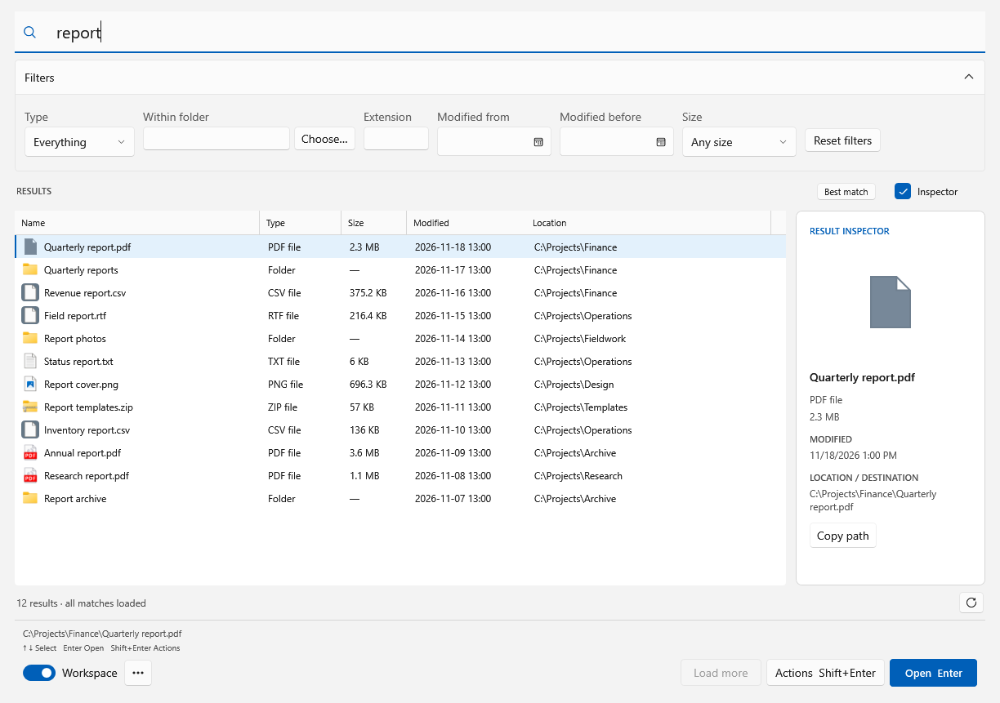
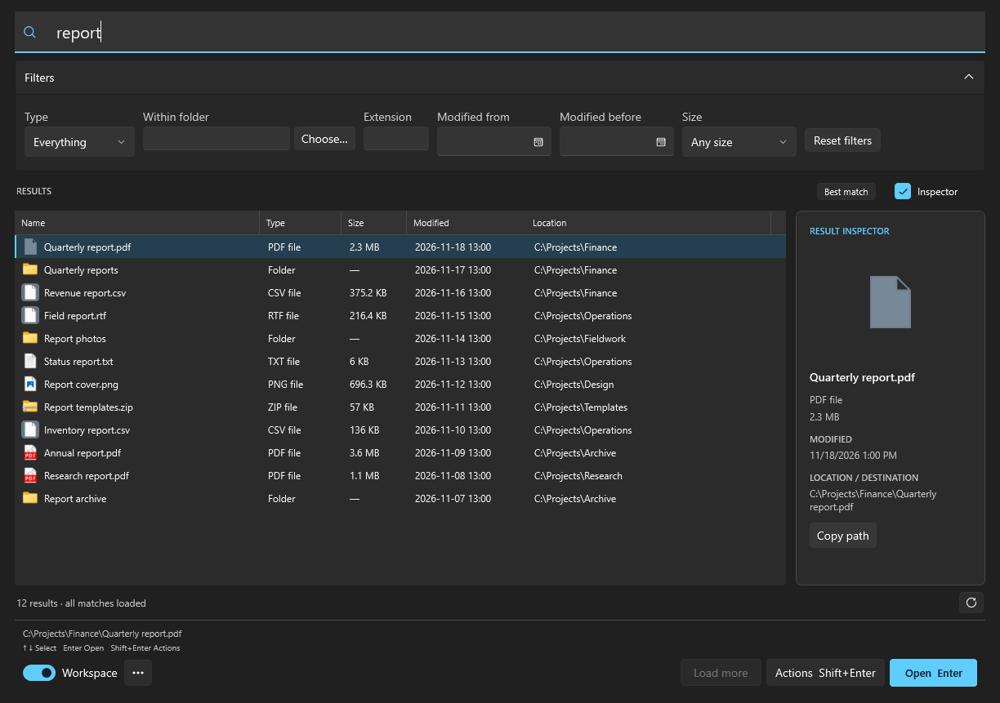
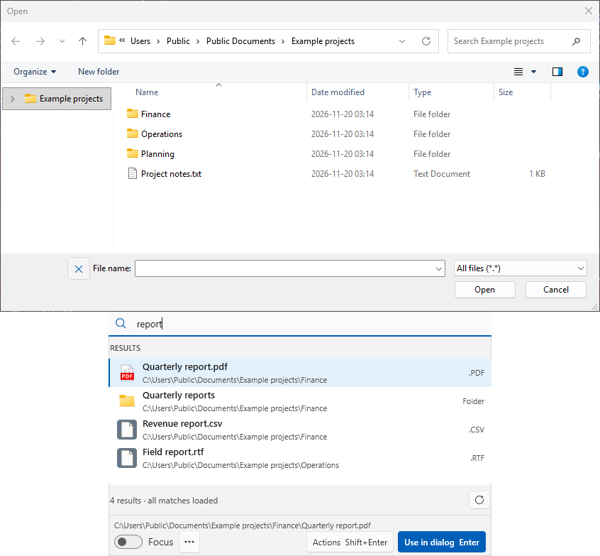

  

<h1 align="center">Search &amp; Launch</h1>

Open a file buried five folders deep, launch an app, or jump to a Windows setting from wherever you’re working.

  <strong><a href="https://github.com/Thypari/SearchAndLaunch-Releases/releases/latest">Download for Windows 11 (x64)</a></strong>
  &nbsp;·&nbsp;
  <a href="https://github.com/Thypari/SearchAndLaunch-Releases/releases">Release notes</a>

## Features

- **Instant file and folder search.** Press <kbd>Ctrl</kbd> + <kbd>Alt</kbd> + <kbd>Space</kbd> and enter part of a name. Results from your indexed drives appear as you type. You can also paste a full path.
- **Launch straight from the keyboard.** Press <kbd>Enter</kbd> to open a file, jump to a folder, start an app, or open a Windows setting. Skip the hunt through desktop icons, the Start menu, and folder trees. Items you open get a boost in later searches that match them.
- **Act on a result.** Right-click or press <kbd>Shift</kbd> + <kbd>Enter</kbd> for Windows actions. For example, **Reveal in File Explorer** opens the containing folder with the file already selected.
- **Search inside Explorer and file dialogs.** In Explorer, search starts in the current folder. In a supported Open or Save dialog, you can pick a file or jump to a different folder while keeping the filename you’ve typed.
- **A quick launcher or a full Workspace.** Use **Focus** to open the first good match. Switch to **Workspace** to filter by folder or extension, sort results, and inspect a file’s full path. Both views support **Light**, **Dark**, or **System** to follow Windows.
- **Exclude clutter.** Add files or folders to **Exclusions** to hide them from your own results. Use **Do not index** to leave a location out of the shared index for everyone on the PC.
- **Confidential mode.** Keep chosen files and folders hidden from search until you unlock them with your password. By default, hiding the search window locks Confidential mode again.
- **Low index memory by default.** New installations use the lowest RAM setting for the size of your index. Every indexed file stays searchable. Raise the percentage in **Settings → Index → Manage index** if you want to keep more in RAM.
- **Fewer background disk writes.** After the first scan, the indexer follows the Windows file-change journal and saves changes in batches. It groups repeated size and date changes in busy temp and log folders and skips saves when the index is unchanged.

## Screenshots

### Focus in light and dark

Typing `report` finds both *Quarterly report.pdf* and the *Quarterly reports* folder. Use <kbd>↑</kbd> or <kbd>↓</kbd> to choose between them. Select a screenshot to see it at full size.

  
  

### Workspace in light and dark

When several reports have similar names, compare their folders, sizes, and modification dates side by side. Use **Within folder** to narrow the search to a project, or enter `pdf` in **Extension**.

  
  

### Picking a file in an Open dialog

Here the search panel sits beneath the dialog. Choose **Use in dialog** to pass the selected report back to it. The magnifier beside **File name** hides or shows the panel.

  

## Install and update

1. Open the [latest release](https://github.com/Thypari/SearchAndLaunch-Releases/releases/latest) and download the **Windows x64 MSI** under **Assets**.
2. Run the installer. Administrator approval installs the shared indexing service. Choose whether Start menu and sign-in shortcuts are for **this user** or **all users**.
3. Open the launcher from the tray beside the clock or press <kbd>Ctrl</kbd> + <kbd>Alt</kbd> + <kbd>Space</kbd>. On first use, the service indexes file and folder names on supported local NTFS drives in the background.

The app checks for updates at launch by default. You can change that under **Settings → General → Updates**, or choose **Check for Update** from the tray menu at any time.
